# KatTopBar

An improved version of RO2016 TopBar like TopBarPlus on Roblox, featuring the ability to create custom icons, text elements, Leaderstats columns and more.

## Preview

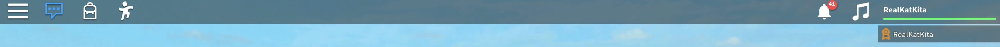

## Features

- Left, center, and right button alignment
- Automatic icon centering
- Custom icon sizes and positions
- Toggle and Momentary button modes
- Active and inactive icons
- Notification counters
- Button ordering and visibility control
- Custom text elements
- Custom Leaderstats columns
- Automatic custom column visibility based on screen resolution and orientation
- Automatic spacing for standard CoreGui Leaderstats
- TopBar transparency and color control
- Automatically restore the TopBar on removal

## Installation

[Download KatTopBar script](KatTopBar.lua)

Place `KatTopBar` inside `ReplicatedStorage`.

Require and initialize it from a `LocalScript`:

```lua
local ReplicatedStorage = game:GetService("ReplicatedStorage")
local KatTopBar = require(ReplicatedStorage:WaitForChild("KatTopBar"))

KatTopBar:Init()
```

## Quick Start

Example of a music toggle button

```lua
local sound = workspace:WaitForChild("Sound")

local musicButton = KatTopBar:AddButton({
    Name = "Music",
    Icon = "rbxassetid://7059338404",
    IconSize = UDim2.new(0, 28, 0, 27),
    Type = "center",
    Mode = "Toggle"
})

musicButton.Clicked:Connect(function(active, button)
    if active then
        sound:Play()
        button:SetIconColor(Color3.fromRGB(3, 162, 245)) -- Blue
    else
        button:SetIconColor(Color3.fromRGB(255, 255, 255)) -- White
        sound:Stop()
    end
end)
```

### Preview

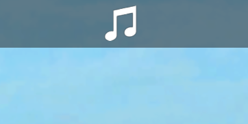

## AddButton(config)

Creates a button and returns its button object.

| Property | Type | Default | Description |
|---|---|---|---|
| `Name` | string | Button ID | Gui button name |
| `Icon` | string | `""` | Default icon |
| `ActiveIcon` | string? | `nil` | Icon displayed when active |
| `Size` | UDim2 | `50 × 36` | Button size |
| `IconSize` | UDim2 | `22 × 28` | Icon size |
| `IconPosition` | UDim2? | Automatic | Custom icon position |
| `Position` | UDim2? | `nil` | Alternative to `IconPosition` |
| `Type` | string | `"left"` | Button alignment |
| `Mode` | string | `"Toggle"` | Button behavior |
| `Order` | number | Next available order | Position within its group |
| `Active` | boolean | `false` | Initial active state |
| `Visible` | boolean | `true` | Button visibility |
| `IconColor` | Color3 | White | Icon tint |
| `Counter` | boolean | `false` | Enable notification counter |
| `CounterValue` | any | `nil` | Initial counter value |

### Button Alignment

The `Type` property controls the button group:

| Type | Description |
|---|---|
| `"left"` | Left side, after the system Chat and Backpack offsets |
| `"center"` | Centered group of buttons |
| `"right"` | Right side, with a 170 pixel offset from the edge |

`Order` controls the order of buttons within their group. Buttons with the same order retain their creation order.

### Button Modes

- `Toggle` — switches the active state with each click.
- `Momentary` — remains active only while the mouse button is held.

## Icon Positioning

Icons are automatically centered when `IconPosition` is not specified.

```lua
KatTopBar:AddButton({
    Name = "Shop",
    Icon = "rbxassetid://13429538917",
    IconSize = UDim2.new(0, 26, 0, 31),
})
```

### Preview

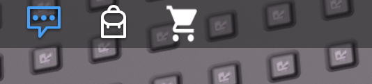

To specify a custom position:

```lua
KatTopBar:AddButton({
    Name = "Shop",
    Icon = "rbxassetid://13429538917",
    IconSize = UDim2.new(0, 26, 0, 31),
    IconPosition = UDim2.new(1, -26, 0, 0)
})
```

Set the position to `nil` to restore automatic centering:

```lua
shopButton:SetIconPosition(nil)
```

## Button API

Every button returned by `AddButton()` provides the following methods:

| Method | Description |
|---|---|
| `SetActive(boolean)` | Set the active state |
| `SetSize(UDim2)` | Change button size |
| `SetIcon(string)` | Change the default icon |
| `SetActiveIcon(string)` | Change the active icon |
| `SetIconSize(UDim2)` | Change icon size |
| `SetIconPosition(UDim2 or nil)` | Change icon position |
| `SetIconColor(Color3)` | Change icon color |
| `SetOrder(number)` | Change button order |
| `SetType(string)` | Change alignment group |
| `SetMode(string)` | Change button mode |
| `SetVisible(boolean)` | Change visibility |
| `SetCounter(any)` | Update counter value |
| `EnableCounter(any)` | Enable the counter |
| `Destroy()` | Remove the button |

## Events

### Clicked

Fires when the button is clicked.

```lua
testButton.Clicked:Connect(function(active, button)
    print("Active:", active)
    print("Button:", button.Name)
end)
```

Arguments:

- `active` — current button state.
- `button` — button object.

### StateChanged

Fires whenever the `Active` state changes.

```lua
testButton.StateChanged:Connect(function(active, button)
    print("State changed:", active)
end)
```

This event does not fire if the state remains unchanged.

## Notification Counter

Enable a counter when creating a button:

```lua
local notificationButton = KatTopBar:AddButton({
    Name = "Notifications",
    Icon = "rbxassetid://70856241901857",
    IconSize = UDim2.new(0, 28, 0, 27),
    Counter = true,
    CounterValue = 5
})
```

### Preview

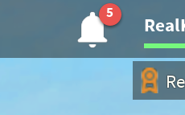

Update the counter:

```lua
notificationButton:SetCounter(10)
```

### Preview

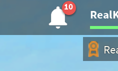

Hide the counter by setting its value to `0`:

```lua
notificationButton:SetCounter(0)
```

### Preview

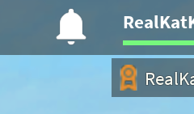

Enable a counter after creating a button:

```lua
notificationButton:EnableCounter(3)
```

### Preview

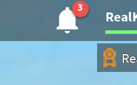

## AddText(config)

Creates a text element inside the TopBar and returns its text object.

| Property | Type | Default | Description |
|---|---|---|---|
| `Name` | string | Text ID | Gui object name |
| `Text` | string | `""` | Displayed text |
| `Size` | UDim2 | `77 × TopBar height` | Text element size |
| `Font` | Enum.Font | `Enum.Font.SourceSans` | Text font |
| `TextColor` | Color3 | White | Text color |
| `Type` | string | `"left"` | Text alignment |
| `Order` | number | Next available order | Position within its group |
| `Visible` | boolean | `true` | Text visibility |

### Text Alignment

The `Type` property uses the same alignment groups as buttons:

| Type | Description |
|---|---|
| `"left"` | Left side |
| `"center"` | Centered group |
| `"right"` | Right side |

`Order` controls the position of text elements within their group. Text elements and buttons share the same alignment groups and ordering system.

### Text Example

```lua
local statusText = KatTopBar:AddText({
    Name = "Status",
    Text = "Online",
    Size = UDim2.new(0, 100, 1, 0),
    Font = Enum.Font.SourceSansBold,
    TextColor = Color3.fromRGB(0, 255, 0),
    Type = "left",
    Order = 1
})
```

### Preview

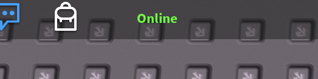

### Text API

Every text element returned by `AddText()` provides the following methods:

| Method | Description |
|---|---|
| `SetText(string)` | Change displayed text |
| `SetTextColor(Color3)` | Change text color |
| `SetFont(Enum.Font)` | Change font |
| `SetSize(UDim2)` | Change element size |
| `SetOrder(number)` | Change element order |
| `SetType(string)` | Change alignment group |
| `SetVisible(boolean)` | Change visibility |
| `Destroy()` | Remove the text element |

Text size is fixed to `Enum.FontSize.Size14` for RO2016 compatibility. `TextSize` and a custom font size setting are not supported.

### Text Clicked

Text elements also support the `Clicked` event.

```lua
statusText.Clicked:Connect(function(textElement)
    print("Clicked:", textElement.Text)
end)
```

Argument:

- `textElement` — text element object.

## AddLeaderstatsColumn(config)

Creates a custom Leaderstats column and returns its column object.

Each column contains a name label and a value label.

| Property | Type | Default | Description |
|---|---|---|---|
| `Name` | string | `"Column"` | Column name |
| `Value` | string or number | `""` | Displayed value |
| `Order` | number | Next available order | Column position |
| `Visible` | boolean | `true` | Column visibility |
| `NameColor` | Color3 | White | Name text color |
| `ValueColor` | Color3 | White | Value text color |

Each custom column has a fixed width of 77 pixels.

### Leaderstats Column Example

```lua
local coinsColumn = KatTopBar:AddLeaderstatsColumn({
    Name = "Coins",
    Value = 1500,
    Order = 1,
    NameColor = Color3.fromRGB(255, 220, 80),
    ValueColor = Color3.fromRGB(255, 255, 255)
})
```

### Preview

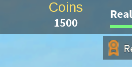

### Leaderstats Column API

Every column returned by `AddLeaderstatsColumn()` provides the following methods:

| Method | Description |
|---|---|
| `SetName(string)` | Change column name |
| `SetValue(string or number)` | Change displayed value |
| `SetOrder(number)` | Change column order |
| `SetVisible(boolean)` | Change visibility |
| `SetNameColor(Color3)` | Change name text color |
| `SetValueColor(Color3)` | Change value text color |
| `Destroy()` | Remove the column |

### Leaderstats Clicked

Custom columns also support the `Clicked` event

```lua
coinsColumn.Clicked:Connect(function(column)
    print("Column:", column.Name)
    print("Value:", column.Value)
end)
```

Argument:

- `column` — custom Leaderstats column object

### Automatic Column Visibility

Custom Leaderstats columns automatically adjust to the screen orientation and resolution

- Portrait orientation custom columns are hidden
- Landscape with a width below 700 pixels or a height below 500 pixels only one custom column is displayed
- Other landscape resolutions all visible custom columns are displayed

### CoreGui Leaderstats Spacing

KatTopBar automatically reserves space for the standard Roblox CoreGui `leaderstats`.

This prevents right-aligned buttons and custom columns from overlapping the standard Leaderstats display

The reserved width is calculated using the number of unique stat names:

- Landscape orientation up to four standard columns
- Landscape with a width below 700 pixels or a height below 500 pixels up to one standard column
- Portrait orientation no space is reserved

Custom Leaderstats columns and standard coregui Leaderstats use separate calculations, but their widths are combined when positioning TopBar elements

## KatTopBar API

| Method | Description |
|---|---|
| `Init()` | Initialize the module |
| `Destroy()` | Stop the module and remove its buttons, columns, text elements and Gui |
| `MakeTopBar()` | Create or restore the TopBar Gui |
| `SetTopbarTransparency(number)` | Set background transparency |
| `GetTopbarTransparency()` | Get current background transparency |
| `ResetTopbarTransparency()` | Set background transparency to 0.5 |
| `SetTopbarColor(Color3)` | Set background color |
| `GetTopbarColor()` | Get current background color |
| `ResetTopbarColor()` | Set background color to 31, 31, 31 RGB |
| `AddButton(config)` | Create a button |
| `AddText(config)` | Create a text element |
| `AddLeaderstatsColumn(config)` | Create a custom Leaderstats column |

### Module Properties

| Property | Description |
|---|---|
| `Initialized` | Whether the module is initialized |
| `Version` | Current module version |
| `TopbarTransparency` | Current TopBar background transparency |
| `TopBarColor` | Current TopBar background color |
| `Gui` | Main ScreenGui object |
| `Buttons` | Table containing created buttons |
| `Texts` | Table containing created text elements |
| `LeaderstatsColumns` | Table containing custom Leaderstats columns |
| `Elements` | Table containing all registered elements |
| `TransparencyChanged` | Transparency changed event |
| `ColorChanged` | Color changed event |

### TransparencyChanged

Fires when the TopBar transparency changes.

```lua
KatTopBar.TransparencyChanged:Connect(function(transparency)
    print("Transparency:", transparency)
end)
```

Change transparency:

```lua
KatTopBar:SetTopbarTransparency(0.2)
```

### Preview

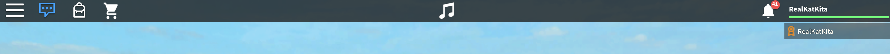

### ColorChanged

Fires when the TopBar color changes.

```lua
KatTopBar.ColorChanged:Connect(function(color)
    print("Color:", color)
end)
```

Change color:

```lua
KatTopBar:SetTopbarColor(Color3.fromRGB(100, 0, 0))
```

To Red

### Preview

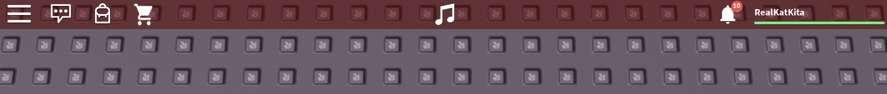

```lua
KatTopBar:SetTopbarColor(Color3.fromRGB(0, 100, 0))
```

To Green

### Preview

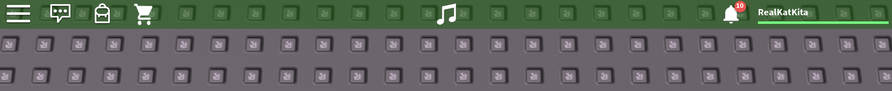

```lua
KatTopBar:SetTopbarColor(Color3.fromRGB(0, 0, 100))
```

To Blue

### Preview

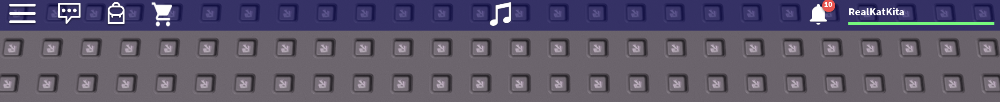

## Complete Example

```lua
local ReplicatedStorage = game:GetService("ReplicatedStorage")
local KatTopBar = require(ReplicatedStorage:WaitForChild("KatTopBar"))
local sound = workspace:WaitForChild("Sound")

KatTopBar:Init()

local shopButton = KatTopBar:AddButton({
    Name = "Shop",
    Icon = "rbxassetid://13429538917",
    IconSize = UDim2.new(0, 26, 0, 31),
    Type = "left",
    Mode = "Toggle"
})

local musicButton = KatTopBar:AddButton({
    Name = "Music",
    Icon = "rbxassetid://7059338404",
    IconSize = UDim2.new(0, 25, 0, 26),
    Type = "center",
    Mode = "Toggle"
})

local notificationButton = KatTopBar:AddButton({
    Name = "Notifications",
    Icon = "rbxassetid://70856241901857",
    Type = "right",
    IconSize = UDim2.new(0, 28, 0, 27),
    Counter = true,
    CounterValue = 41
})

local statusText = KatTopBar:AddText({
    Name = "Status",
    Text = "Online",
    Size = UDim2.new(0, 100, 1, 0),
    Type = "left",
    Order = 2
})

local coinsColumn = KatTopBar:AddLeaderstatsColumn({
    Name = "Coins",
    Value = 1500,
    Order = 1
})

shopButton.Clicked:Connect(function()
    print("Shop opened")
    -- other stuff
end)

musicButton.Clicked:Connect(function(active, button)
    if active then
        sound:Play()
        button:SetIconColor(Color3.fromRGB(3, 162, 245)) -- Blue
    else
        button:SetIconColor(Color3.fromRGB(255, 255, 255)) -- White
        sound:Stop()
    end
end)

notificationButton.Clicked:Connect(function()
    notificationButton:SetCounter(0)
    -- other stuff
end)

statusText.Clicked:Connect(function(textElement)
    print("Status:", textElement.Text)
end)

coinsColumn.Clicked:Connect(function(column)
    print("Coins:", column.Value)
end)
```

## Compatibility

KatTopBar is designed for client side use through a `LocalScript`.

Mouse input is handled through `UserInputService` and cursor based hit detection rather than gui button click events because of the RO2016 TopBar

The module requires a client environment and does not work correctly in clients that lack a TopBar

## Idea

The script is inspired by TopBarPlus on Roblox.
