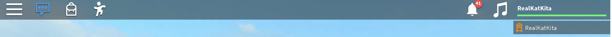

# KatTopBar

An improved version of RO2016 TopBar like TopBarPlus on Roblox, featuring the ability to create custom icons and more 

## Preview



## Features

- Left, center, and right button alignment
- Automatic icon centering
- Custom icon sizes and positions
- Toggle and Momentary button modes
- Active and inactive icons
- Notification counters
- Button ordering and visibility control
- TopBar transparency control
- Automatically restore the TopBar on removal 

## Installation

[Download KatTopBar.luau](KatTopBar.lua)

Place `KatTopBar` inside `ReplicatedStorage`.

Require and initialize it from a `LocalScript`:

```lua
local ReplicatedStorage = game:GetService("ReplicatedStorage")
local KatTopBar = require(ReplicatedStorage:WaitForChild("KatTopBar"))

KatTopBar:Init()
```

## Quick Start
Example of a music toggle button

```lua
local sound = workspace:WaitForChild("Sound")

local musicButton = KatTopBar:AddButton({
    Name = "MusicToggle",
    Icon = "rbxassetid://123456789",
    Type = "right",
    Mode = "Toggle"
})

musicButton.Clicked:Connect(function(active)
    if active then
        sound:Play() 
    else
        sound:Stop()
    end
end)
```

## AddButton(config)

Creates a button and returns its button object.

| Property | Type | Default | Description |
|---|---|---|---|
| `Name` | string | Button ID | Gui button name |
| `Icon` | string | `""` | Default icon |
| `ActiveIcon` | string? | `nil` | Icon displayed when active |
| `Size` | UDim2 | `50 × 36` | Button size |
| `IconSize` | UDim2 | `22 × 28` | Icon size |
| `IconPosition` | UDim2? | Automatic | Custom icon position |
| `Position` | UDim2? | `nil` | Alternative to `IconPosition` |
| `Type` | string | `"left"` | Button alignment |
| `Mode` | string | `"Toggle"` | Button behavior |
| `Order` | number | Next available order | Position within its group |
| `Active` | boolean | `false` | Initial active state |
| `Visible` | boolean | `true` | Button visibility |
| `IconColor` | Color3 | White | Icon tint |
| `Counter` | boolean | `false` | Enable notification counter |
| `CounterValue` | any | `nil` | Initial counter value |

### Button Alignment

The `Type` property controls the button group:

| Type | Description |
|---|---|
| `"left"` | Left side, after the system Chat and Backpack offsets |
| `"center"` | Centered group of buttons |
| `"right"` | Right side, with a 170 pixel offset from the edge |

`Order` controls the order of buttons within their group. Buttons with the same order retain their creation order.

### Button Modes

- `Toggle` — switches the active state with each click.
- `Momentary` — remains active only while the mouse button is held.

## Icon Positioning

Icons are automatically centered when `IconPosition` is not specified.

```lua
KatTopBar:AddButton({
    Name = "Shop",
    Icon = "rbxassetid://15385835524",
    IconSize = UDim2.new(0, 28, 0, 27)
})
```

To specify a custom position:

```lua
KatTopBar:AddButton({
    Name = "Shop",
    Icon = "rbxassetid://15385835524",
    IconSize = UDim2.new(0, 28, 0, 27),
    IconPosition = UDim2.new(1, -28, 0, 0)
})
```

Set the position to `nil` to restore automatic centering:

```lua
shopButton:SetIconPosition(nil)
```

## Button API

Every button returned by `AddButton()` provides the following methods:

| Method | Description |
|---|---|
| `SetActive(boolean)` | Set the active state |
| `SetSize(UDim2)` | Change button size |
| `SetIcon(string)` | Change the default icon |
| `SetActiveIcon(string)` | Change the active icon |
| `SetIconSize(UDim2)` | Change icon size |
| `SetIconPosition(UDim2 or nil)` | Change icon position |
| `SetIconColor(Color3)` | Change icon color |
| `SetOrder(number)` | Change button order |
| `SetType(string)` | Change alignment group |
| `SetMode(string)` | Change button mode |
| `SetVisible(boolean)` | Change visibility |
| `SetCounter(any)` | Update counter value |
| `EnableCounter(any)` | Enable the counter |
| `Destroy()` | Remove the button |

## Events

### Clicked

Fires when the button is clicked.

```lua
testButton.Clicked:Connect(function(active, button)
    print("Active:", active)
    print("Button:", button.Name)
end)
```

Arguments:
- `active` — current button state.
- `button` — button object.

### StateChanged

Fires whenever the `Active` state changes.

```lua
testButton.StateChanged:Connect(function(active, button)
    print("State changed:", active)
end)
```

This event does not fire if the state remains unchanged.

## Notification Counter

Enable a counter when creating a button:

```lua
local notificationButton = KatTopBar:AddButton({
    Name = "Notifications",
    Icon = "rbxassetid://70856241901857",
    Counter = true,
    CounterValue = 5
})
```

Update the counter:

```lua
notificationButton:SetCounter(10)
```

Hide the counter by setting its value to `0`:

```lua
notificationButton:SetCounter(0)
```

Enable a counter after creating a button:

```lua
notificationButton:EnableCounter(3)
```

## KatTopBar API

| Method | Description |
|---|---|
| `Init()` | Initialize the module |
| `Destroy()` | Stop the module and remove its buttons and Gui |
| `MakeTopBar()` | Create or restore the TopBar Gui |
| `SetTopbarTransparency(number)` | Set background transparency |
| `GetTopbarTransparency()` | Get current background transparency |
| `AddButton(config)` | Create a button |

### TransparencyChanged

Fires when the TopBar transparency changes.

```lua
KatTopBar.TransparencyChanged:Connect(function(transparency)
    print("Transparency:", transparency)
end)
```

Change transparency:

```lua
KatTopBar:SetTopbarTransparency(0.2)
```

## Complete Example

```lua
local ReplicatedStorage = game:GetService("ReplicatedStorage")
local KatTopBar = require(ReplicatedStorage:WaitForChild("KatTopBar"))
local sound = workspace:WaitForChild("Sound")

KatTopBar:Init()

local shopButton = KatTopBar:AddButton({
    Name = "Shop",
    Icon = "rbxassetid://15385835524",
    Type = "left",
    Mode = "Toggle"
})

local musicButton = KatTopBar:AddButton({
    Name = "Music",
    Icon = "rbxassetid://987654321",
    Type = "center",
    Mode = "Toggle"
})

local notificationButton = KatTopBar:AddButton({
    Name = "Notifications",
    Icon = "rbxassetid://70856241901857",
    Type = "right",
    Counter = true,
    CounterValue = 3
})

shopButton.Clicked:Connect(function()
    print("Shop opened")
end)

musicButton.Clicked:Connect(function(active)
    if active then
        sound:Play() 
    else
        sound:Stop()
    end
end)

notificationButton.Clicked:Connect(function()
    notificationButton:SetCounter(0)
end)
```

## Compatibility

KatTopBar is designed for client side use through a `LocalScript`.

mouse input is handled through `UserInputService` and cursor based hit detection rather than gui button click events cuz the RO2016 TopBar
